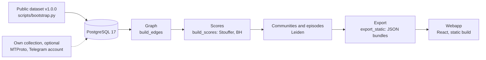

# Idéfix

[](https://github.com/mlabarrere/Idefix/actions/workflows/ci.yml)
[](./LICENSE)
[](./pyproject.toml)

**Propagation and coordination analysis for Telegram public channels.** A
demonstrator that maps observable diffusion structure and produces a ranked,
explainable examination queue for human analysts.

**Idéfix is not a fake-news detector.** It never judges whether a message is
true. It describes *observable structures* of diffusion and coordination and
shows, for each channel, the concrete signals that justify its rank. The
deliverable is a prioritized review queue—never a verdict.

**Idéfix is also not a validated manipulation detector.** Whether a high rank
corresponds to coordinated manipulation rather than to prominence within an
adversarial media ecosystem is an open question this project has not answered.
Read [`docs/limitations.md`](./docs/limitations.md) before drawing any
conclusion from an output.

> [!CAUTION]
> **Personal data.** Idéfix collects, and dataset `v1.0.0` publishes, the
> Telegram user ID, username, and comment text of private individuals who
> commented in the public discussion groups linked to collected channels (the
> `comments` table). The pipeline also writes the IDs and usernames of each
> channel's most frequent commenters into the analyst bundle
> (`commenters.json`, by `scripts/build_commenters.py`), and the analyst
> interface displays them. Read the [datasheet's terms of use](./dataset/DATASHEET.md#uses)
> before you download the corpus or deploy a bundle anywhere others can reach it.

## 🧭 Contents

- [Where to start](#-where-to-start)
- [Reproducibility status](#-reproducibility-status)
- [Architecture](#-architecture)
- [Missions](#-missions)
- [The suspicion score, in brief](#-the-suspicion-score-in-brief)
- [Run it](#-run-it)
- [Supported platforms](#-supported-platforms)
- [Map of the docs](#-map-of-the-docs)
- [The load-bearing limitation](#-the-load-bearing-limitation)
- [Privacy and governance](#-privacy-and-governance)
- [Contributing and security](#-contributing-and-security)
- [Licence, citation, and history](#-licence-citation-and-history)

## 🧭 Where to start

| I want to… | Read |
|---|---|
| See it running | [`docs/ops/quickstart.md`](./docs/ops/quickstart.md), then [`docs/ops/troubleshooting.md`](./docs/ops/troubleshooting.md) if a step fails |
| Read a ranking | [`docs/product/product.md`](./docs/product/product.md) for the queue, [`docs/method/03-suspicion-score.md`](./docs/method/03-suspicion-score.md) for the score, [`docs/reference/glossary.md`](./docs/reference/glossary.md) for the terms, and [`docs/limitations.md`](./docs/limitations.md) before any conclusion |
| Contribute | [`ONBOARDING.md`](./ONBOARDING.md) for a guided tour of the setup and the database, then [`CONTRIBUTING.md`](./CONTRIBUTING.md) and [`docs/STYLE.md`](./docs/STYLE.md) |
| Audit the method | [`METHODOLOGY.md`](./METHODOLOGY.md), the chapters in [`docs/method/`](./docs/method/), the defects in [`docs/limitations.md`](./docs/limitations.md), and the protocols in [`docs/experiments/`](./docs/experiments/) |
| Brief my organization | [`docs/product/product.md`](./docs/product/product.md), [`docs/method/07-tiers-and-governance.md`](./docs/method/07-tiers-and-governance.md), and the five-minute [`docs/ops/demo-runbook.md`](./docs/ops/demo-runbook.md) |
| Use the corpus | [`dataset/DATASHEET.md`](./dataset/DATASHEET.md) and [`dataset/README.md`](./dataset/README.md) |

## 📊 Reproducibility status

**The corpus is public; the results are not regenerated yet.**

- The previously collected corpus is published as **dataset `v1.0.0`**: the
  complete database snapshot—channels, channel posts, and comments from public
  Telegram channels and their public discussion groups—as a GitHub Release
  asset pinned by SHA-256 in [`dataset/manifest.json`](./dataset/manifest.json),
  described by its datasheet, [`dataset/DATASHEET.md`](./dataset/DATASHEET.md).
- From it, anyone can rebuild every derived table and every analyst bundle
  with one command ([Run it](#-run-it)). No Telegram account is needed.
- [`docs/experiments/`](./docs/experiments/) contains falsification
  protocols. `docs/experiments/results/` stays empty until each figure is
  regenerated from that corpus.

> [!WARNING]
> The snapshot also carries the derived tables of an earlier pipeline run; the
> bootstrap recomputes them, and only regenerated numbers may be cited
> ([D18](./docs/limitations.md#d18)). The figures from the June 2026 runs stay
> quarantined under [`archive/`](./archive/) and may not be cited: they came
> from an earlier pipeline, and recomputing on the public corpus is not
> expected to reproduce them.

[`METHODOLOGY.md`](./METHODOLOGY.md) is the versioned cover page of the method.
Bundles carry a static methodology version string, not a hash of it
([D20](./docs/limitations.md#d20)).

## 🧩 Architecture

Two strictly disjoint halves: an **offline analytical pipeline** (Python) that
materializes JSON bundles, and a **fully static analyst interface** (React) that
reads only those bundles. The browser never touches the database.



In words: raw channels and posts reach PostgreSQL 17 in one of two ways,
restored from the public dataset by `scripts/bootstrap.py` (the default, no
credentials) or collected from Telegram with your own account (optional). The
offline pipeline, `scripts/pipeline.py`, builds the channel graph
(`build_edges`), scores the channels (`build_scores`, Stouffer combination and
Benjamini–Hochberg control), detects communities (Leiden) and episodes, and
writes JSON bundles into `webapp/public/data/<mission>/` (`export_static` among
the stages that write them). The React interface is a static site that reads
those local JSON files, with no backend.

**Bundles are not published in this repository.** They are corpus- and
run-specific by construction, so shipping them would publish numbers nobody can
regenerate. The bootstrap produces them locally from the public corpus.

| Layer | Technology | Notes |
|---|---|---|
| Corpus | Public dataset `v1.0.0` | Complete `pg_dump` snapshot of the collected database, fetched and verified against `dataset/manifest.json` |
| Ingestion (optional) | MTProto (Telegram) | **Public channels only**, one dedicated read-only account, `FLOOD_WAIT` discipline |
| Storage | PostgreSQL 17 | Messages, edges, scores. Docker Compose locally (`docker-compose.yml`); any PostgreSQL 17, such as Supabase, otherwise |
| Graph | NetworkX `MultiDiGraph` and igraph/Leiden | Rebuilt **in memory, on demand**. No graph-database server |
| Scoring | Pure Python, no network calls | Per-family p-values, Stouffer combination, Benjamini–Hochberg FDR control |
| Embeddings | `sentence-transformers`, local | `paraphrase-multilingual-MiniLM-L12-v2` (384-dim, FR/RU/EN), deterministic offline cache |
| Communities | Leiden, two tracks | **analytics** (link graph) and **embeddings** (plus semantic edges) |
| Frontend | React 18, Vite, and TypeScript | Strict mode, Cytoscape, Radix, Tailwind CSS v4. **100% static build** |
| Delivery | Any static host | `vite build`; the browser reads local JSON only |

```text
Idefix/
├── METHODOLOGY.md      versioned cover page of the method
├── docs/               method · experiments · limitations · references · ops
├── dataset/            public corpus: manifest (SHA-256 pins), datasheet, README
│   └── downloads/      fetched artefacts land here (gitignored)
├── docker-compose.yml  local PostgreSQL 17 for the public corpus
├── archive/            artefacts from an earlier pipeline — do not cite
├── src/
│   ├── ingestor/       MTProto client (public channels, read-only)
│   ├── normalizer/     text, URLs, media fingerprints, thematic targeting
│   ├── graph/          channel-centric multiplex graph (NetworkX/igraph)
│   ├── scorer/         score families, null model, Stouffer/BH combination
│   ├── embed/          local sentence-transformers encoder, offline cache
│   ├── dossier/        evidence-first episode dossiers
│   ├── missions/       one mission = one MissionDefinition (auto-discovered)
│   ├── validation_lab/ external-gold schemas (non-circular validation)
│   └── shared/         DB, secret scrubbing, snapshot store
├── scripts/            bootstrap, pipeline runner, collection and evaluation CLIs
├── webapp/             React + Vite + TS analyst interface (static build)
├── alembic/            PostgreSQL migrations (head: 0008)
└── tests/              pytest suite + strict frontend typecheck
```

## 🧩 Missions

**One engine, N missions.** A [mission](./docs/reference/glossary.md#mission)
is a *configuration*—source universe, lexicon, targeting weights, scoring
profile, dashboard, and export—never a code fork. The packaged missions are
`russosphere`, `france_ukraine`, `gan` (whose gate calibration is **not
reconciled** with `russosphere`, [D15](./docs/limitations.md#d15)), and
`dircom_minarm`, which is not implemented and refuses live selection until a
crawl populates it. The table of missions is in
[`docs/method/01-problem-and-scope.md`](./docs/method/01-problem-and-scope.md);
adding one is described in [`docs/ops/multi-mission.md`](./docs/ops/multi-mission.md).

**Load-bearing constraint:** thematic relevance and adversary linkage modulate
**severity**, never **inclusion**. No channel is excluded from the queue for
being off-theme, and because the modulation is multiplicative, a channel with
zero structural suspicion stays at zero whatever its relevance.

## 📊 The suspicion score, in brief

Each score family produces a one-sided p-value; the p-values are combined by
weighted Stouffer and controlled for false discovery rate across channels.
Families (b) cascade role and (d) forward influence are active with a null
model; (c) coordination is active with no null model, so its p-value is a
placeholder ([D2](./docs/limitations.md#d2)); (f) semantic coherence is
computed but never reaches the score or the gate
([D19](./docs/limitations.md#d19)); (a) and (e) have never been wired. The
families, the combiner, and their defects are in
[`docs/method/03-suspicion-score.md`](./docs/method/03-suspicion-score.md).

**Multi-source gate:** a channel meets the gate when **at least two distinct
families** trigger, and only then is it T2. The triggered set is persisted
(`channel_scores.gate_families`, Alembic revision `0008`), so tier assignment is
auditable from the stored record. The gate decides the tier only: the severity
modulation applies to every channel, whether or not it meets the gate
([D21](./docs/limitations.md#d21)). Separately, a channel is **flagged** when
Benjamini–Hochberg control rejects it at the mission's `alpha`; flagging changes
neither the score, nor the gate, nor the tier. See the
[glossary](./docs/reference/glossary.md) for each term.

## 🚀 Run it

One command takes a fresh clone to a running analyst interface on the public
corpus, with **no Telegram account and no credentials**. Follow
[`docs/ops/quickstart.md`](./docs/ops/quickstart.md), the one setup tutorial:
it lists the prerequisites, shows the expected output of each step, and links
every failure to its fix in
[`docs/ops/troubleshooting.md`](./docs/ops/troubleshooting.md).

Elsewhere:

- Manual setup, including a managed database:
  [`docs/ops/install.md`](./docs/ops/install.md).
- Every script, its flags, and the pipeline stages:
  [`scripts/README.md`](./scripts/README.md).
- The analyst interface: [`webapp/README.md`](./webapp/README.md) and
  [`docs/product/frontend.md`](./docs/product/frontend.md).
- Tests and checks: [`CONTRIBUTING.md`](./CONTRIBUTING.md).
- Evaluation: [`docs/experiments/`](./docs/experiments/). The evaluation
  harness still cannot run from a clean clone
  ([D12](./docs/limitations.md#d12)).

<a id="8-collect-your-own-data-optional-advanced"></a>

### Collect your own data (optional, advanced)

Nothing above needs this. Collection extends or replaces the public corpus with
channels you crawl yourself, and it is the only part of the system that
contacts Telegram: MTProto, read-only, public channels, one serialized
session. `scripts/enrich_recrawl.py` collects the **commenters of linked public
groups, which is personal data** ([Privacy and governance](#-privacy-and-governance)).
A database you have collected into is no longer dataset `v1.0.0`; results from
it are not comparable with results from the public corpus. Step by step:
[`docs/ops/install.md`](./docs/ops/install.md).

## 🧪 Supported platforms

[`.github/workflows/setup-smoke.yml`](./.github/workflows/setup-smoke.yml) runs
a fresh clone on each operating system below, with Python 3.14 (installed by
uv) and Node.js 22. It runs on Mondays at 05:41 UTC, on demand, and on pull
requests that change `pyproject.toml`, `uv.lock`, `docs/ops/`, or the workflow
itself.

| Platform | Runner | `uv sync --extra dev` | Offline tests | Prerequisite check |
|---|---|---|---|---|
| Ubuntu | `ubuntu-latest` | ✅ Verified | ✅ Verified | ✅ Verified: `uv run python scripts/bootstrap.py check --skip-embeddings`, with Docker |
| macOS | `macos-14` | ✅ Verified | ✅ Verified | 🟠 Partly verified: Python, Node.js and npm, the `embed` extra (reported, not required), the database port, and the dataset manifest; no Docker |
| Windows | `windows-latest` | ✅ Verified | ✅ Verified | 🟠 Partly verified: as on macOS; no Docker |

The smoke test does not download the dataset, restore the database, run the
pipeline, or start the interface. That end-to-end path runs in
[`.github/workflows/reproduce.yml`](./.github/workflows/reproduce.yml), on
Ubuntu only, every Monday and on demand.

## 📚 Map of the docs

| Area | Where | What it holds |
|---|---|---|
| Index | [`docs/README.md`](./docs/README.md) | Every document, one line each |
| Method | [`METHODOLOGY.md`](./METHODOLOGY.md), [`docs/method/`](./docs/method/) | What the system computes, traced to code |
| Defects | [`docs/limitations.md`](./docs/limitations.md) | What bounds every claim, including known, unfixed defects |
| Experiments | [`docs/experiments/`](./docs/experiments/) | Falsification protocols; no result yet |
| Operations | [`docs/ops/`](./docs/ops/) | Quickstart, troubleshooting, install, migrations, missions, demo |
| Product | [`docs/product/`](./docs/product/) | Deliverables, the analyst interface, locales |
| Reference | [`docs/reference/`](./docs/reference/) | Glossary and bibliography |
| Dataset | [`dataset/`](./dataset/) | Manifest, datasheet, and how to fetch and verify the corpus |
| Scripts | [`scripts/README.md`](./scripts/README.md) | Every command-line script |
| Style | [`docs/STYLE.md`](./docs/STYLE.md) | House style and the documentation checks |

## 📊 The load-bearing limitation

> [!WARNING]
> **Telegram coverage only.** The mass-amplification layer on other platforms is
> not observed. An operation reaching France mainly through other platforms,
> without a Telegram stage, **will not be detected.** What is measured is a
> footprint *observable on Telegram*, never the total footprint of a phenomenon.

Every bundle manifest carries it, although the analyst interface no longer
displays it ([D31](./docs/limitations.md#d31)). The complete register of limits
and known defects is [`docs/limitations.md`](./docs/limitations.md).

<a id="11-governance"></a>

## 🔒 Privacy and governance

- **Arm-only.** Outputs go to designated institutional recipients—never to
  platforms, the public, candidates, or press.
- **Tiered vocabulary** (T1/T2/T3) rather than true/false. Any T3 claim
  (real-world attribution) is out of scope and a reportable defect.
- **Structural corroboration.** No T2 label without at least two distinct
  triggered families: the gate enforces it. Severity is not bound by the same
  rule; the severity factor applies whether or not the gate is met
  ([D21](./docs/limitations.md#d21)).
- **ToS-respecting collection.** Public channels only, no scraping outside the
  terms of service, no deanonymization. Channel member lists are not collected.
  `scripts/enrich_recrawl.py` does collect the identifiers, usernames, and text
  of **commenters** in public linked discussion groups (`comments` table)—
  personal data of private individuals. The `build_commenters` pipeline stage
  copies the IDs and usernames of each channel's most frequent commenters,
  without their text, into the analyst bundle, where the channel drawer shows
  them. Secrets are scrubbed by key and by value from the static export.
- **What the public dataset publishes.** The complete database snapshot:
  channel metadata and channel posts (public broadcast content); the
  `comments` table, **including commenter identifiers, usernames, and text**;
  and the derived tables of an earlier pipeline run, including its per-channel
  scores—outputs that the arm-only rule above otherwise reserves for
  designated recipients. Contents and terms of use:
  [`dataset/DATASHEET.md`](./dataset/DATASHEET.md).

The full governance model is in
[`docs/method/07-tiers-and-governance.md`](./docs/method/07-tiers-and-governance.md).

## 🤝 Contributing and security

- **Contributing:** [`CONTRIBUTING.md`](./CONTRIBUTING.md) and the
  [code of conduct](./CODE_OF_CONDUCT.md).
- **Security:** report via [`SECURITY.md`](./SECURITY.md), never as a public
  issue.

## 📚 Licence, citation, and history

- **Licence:** [Apache-2.0](./LICENSE).
- **Dataset:** [`dataset/README.md`](./dataset/README.md) (fetch, verify,
  rebuild); licence and terms of use in
  [`dataset/DATASHEET.md`](./dataset/DATASHEET.md).
- **Citing:** [`CITATION.cff`](./CITATION.cff). Cite the software and, for any
  result computed from the corpus, dataset `v1.0.0`.
- **History:** [`CHANGELOG.md`](./CHANGELOG.md).
