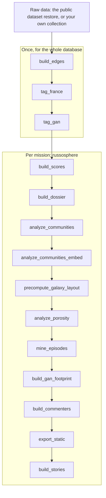

# Multi-mission platform: contributor guide

Canonical scope:
[`../method/01-problem-and-scope.md`](../method/01-problem-and-scope.md) §1.5.

Idéfix is a **theme-agnostic Telegram engine** plus **several analytical
missions**. A mission is a **configuration** (six profiles and a relevance
scorer), never a code fork.

## 🧩 Missions

Each mission is a package under `src/missions/`:

| Mission | `implemented` | Object |
|---|---|---|
| `russosphere` | `True` (default) | Coordinated disinformation targeting the image, integrity, or sovereignty of France |
| `france_ukraine` | `True` | Narratives targeting France in the Ukraine conflict |
| `gan` | `True` | The Telegram-observable informational footprint of the Carrier Strike Group, with an operations security (OPSEC) objective |
| `dircom_minarm` | `False` | Reuse and distortion of the Ministry of the Armed Forces' official communication. It appears in the switcher but refuses live selection |

Each package's `__init__.py` (for example `src/missions/gan/__init__.py`)
exports a module constant `MISSION: MissionDefinition`
(`src/missions/spec.py::MissionDefinition`). It
composes a `SourceUniverse`, a `LexiconProfile`, a `TargetingProfile`, a
`ScoringProfile`, a `DashboardProfile`, an `ExportProfile`, and a
`relevance_scorer`. `src/missions/registry.py` discovers the packages by
convention, and `src/missions/loader.py::resolve_mission` resolves a name,
defaulting to `russosphere`
(`tests/missions/test_registry.py::test_default_mission_is_russosphere`).

**Adding a mission means creating a package and its `MISSION`.** No engine
change is needed.

## 🔧 Per-mission pipeline

`scripts/pipeline.py` runs the offline stages in this order, shown here for the
`russosphere` mission
(`uv run python scripts/pipeline.py --list` prints it with each stage's scope):



`--mission all` runs every implemented mission; each stage runs for all of them
before the next stage starts. A new mission's stages must be registered in
`scripts/pipeline.py::STAGES` to be part of a reproducible run, and the
runner's `MISSIONS` tuple must list the mission (a test keeps it in step with
the registry).

`export_static` and `build_stories` write to the mission's folder under
`webapp/public/data/` by default (for example `webapp/public/data/gan/`), so
`--out` is not needed. Those bundles are ignored by Git by design;
see [Part III of the limitations](../limitations.md).

For `gan`, `scripts/tag_gan.py` merges `channels.extra.gan_targeting` into the
existing keys, so it does not overwrite `fr_score`. `build_scores --mission gan`
materializes the `telegram_*` families (visibility, velocity, source diversity,
disclosure precision, propagation, and adverse attention), scoped by
`channel_scores.mission` (Alembic revisions `0005` and `0006`).

> [!WARNING]
> **Calibration.** The `gan` gate has never been reconciled with `russosphere`,
> and the two missions have produced T2 volumes that differ by more than an
> order of magnitude. Treat `gan` T2 counts as uninterpretable
> ([D15](../limitations.md#d15)).

## 🔒 Scope and secrets

- **Telegram only.** Every `gan` score is named `telegram_*` as a deliberate
  perimeter lock: it measures the footprint observable on Telegram, never the
  total footprint. The caveat is permanent, in the interface and in every
  report.
- **The Telegram account and session** are execution dependencies
  (`src/ingestor/session.py`: the `TELEGRAM_*` variables with `TG_*` aliases,
  and `session_preflight`). They are **never exported**: `export_static`
  scrubs secrets by key and by value.
- **Arm-only** ([glossary](../reference/glossary.md)): outputs go to
  designated institutional recipients. Tiers **T1 and T2** only; T3 is out of
  scope.

## 📊 Scoring

The scorer lives in `src/scorer/`.

- `src/scorer/channel_suspicion.py::compute_channel_queue` takes a
  `ScoringProfile` (`profile=`) and extra family scores (`extra_families=`).
  The structural families, (b) cascade, (c) coordination, and (d) forward
  influence, are theme-agnostic.
- `src/scorer/telegram_footprint.py` holds the `telegram_*` families, and
  `src/scorer/eefi_rubric.py` the graded rubric of essential elements of
  friendly information (EEFI) behind `telegram_disclosure_precision`. Its
  severities are a **business decision**, currently a first seed that awaits
  calibration by the sponsor.
- `src/graph/loader.py::make_prior_policy`, fed from
  `ScoringProfile.credibility_prior_enabled`, makes `credibility_prior`
  mission-aware. `gan` turns it off (a neutral prior), since discussing a
  friendly asset carries no presumption of suspicion.

  Until September 2026 this prior was derived from French-keyword density, a
  language partition. It is now derived from documented adversary linkage; the
  effect of that change on the ranking is unmeasured
  ([D1](../limitations.md#d1)).

Full treatment: [`../method/03-suspicion-score.md`](../method/03-suspicion-score.md).

<a id="analyst-interface"></a>

## 🧩 Analyst interface

`webapp/` is React, Vite, TypeScript, Tailwind CSS, and Radix: a static build
with no backend. It opens on the `russosphere` galaxy and offers a mission
switcher in its sidebar, the galaxy and analysis views, a channel drawer, and
each mission's coverage caveat (`webapp/src/app/AppShell.tsx`). See
[`../../webapp/README.md`](../../webapp/README.md) and
[`../product/frontend.md`](../product/frontend.md).

## 🧪 Validation

Run the tests, then build and type-check the interface:

```bash
uv run --extra dev python -m pytest
```

```bash
cd webapp
npm run build
npx tsc --noEmit
cd ..
```

`uv run python scripts/pipeline.py --mission gan` runs on the public corpus.
Widening the `gan` source universe (more naval and defence seeds) requires your
own collection; see the
[install guide](./install.md#optional-collect-your-own-data-from-telegram).
